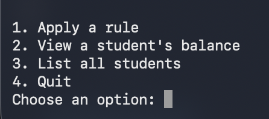

# Student Token Bank
A token tracker for music students, built from scratch while learning Python with both a command-line interface and a web version (via Flask).

I built this to act as a real rewards system for my private students. The studio I worked at already used a token system on paper. I wanted a digital version to make the workflow more efficient. I was independently learning Python at the time and saw this as a strong project to learn on.

## Features
- Creates and maintains a list of students and a token balance for each one.
- Applies rules that add or subtract tokens (see **Token Rules** below) covers things like attendance, homework completion, behavior, and reward redemptions.
- Looks up an individual student's balance.
- Lists every student and their balance at once.
- Removes a student from the roster (with a confirmation step, so it's hard to do by accident).
- Saves to and loads from disk between sessions, so nothing is lost when you close the program.
- Two ways to use it: a command-line menu, or a web page with a form.

## Token Rules
| Rule | Effect |
|---|---|
| `setup` | +0 (adds a new student to the system without changing their balance) |
| `attendance` | +1 |
| `homework` | +1 |
| `extraordinary` | +1 |
| `bad_behavior` | -1 |
| `no_practice` | -1 |
| `small_reward` | -5 |
| `regular_reward` | -20 |
| `big_reward` | -45 |

## How to Run
Command-line version
```
git clone https://github.com/JamesDHoldaway/StudentTokenBank.git
cd StudentTokenBank
python3 -m venv venv
source venv/bin/activate
python3 main.py
```
Web version
(assuming venv is created/activated, see above)
```
pip install -r requirements.txt
python3 app.py
```
Then open the http link printed in the terminal in your browser.

## Project Structure
- `bank.py` the shared logic: the token rules, loading/saving `students.json`, and applying a rule to a student. Both interfaces import from here.
- `main.py` the command-line interface: a menu loop built on top of `bank.py`.
- `app.py` the web interface: a Flask app with a page showing the roster as a table, and a form to apply a rule to a student right from the browser.

## Menu visual


## What is built so far
- CLI with a full menu (apply rule, view balance, list all, remove student, quit)
- JSON persistence between sessions
- Web page showing the live roster
- Web form to apply a rule and save it, right from the browser

## Note
`students.json` is not included in the repo because it holds real students' names, so a freshly cloned copy starts with an empty roster.

James Holdaway (https://github.com/JamesDHoldaway)
